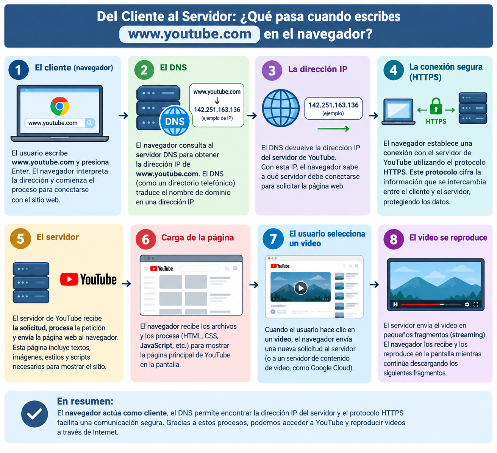

# Fundamentos de Internet 

## 1. Del Cliente al Servidor

1.1 Qué hace el cliente (navegador).
Cuando el usuario escribe www.youtube.com y presiona Enter, el navegador interpreta la dirección, busca la dirección IP del servidor mediante el DNS y establece una conexión para solicitar la página web. Después, recibe la información del servidor, la procesa y muestra el contenido en pantalla. Cuando el usuario selecciona un video, el navegador solicita los datos necesarios para reproducirlo.

1.2 Qué papel cumple el DNS.
El DNS interpreta los nombres de dominio ejemplo: www.youtube.com y lo que devuelve es una direccion IP de 32 bits para caso de IPV4, cuando se trata de IPV6 se devuelve una ip de 64 bits en formato hexadecimal (2001.cafe....). En otras palabras traduce el dominio a direccion IP.

1.3 Qué ocurre con la dirección IP.
El DNS devuelve una dirección IP correspondiente a un servidor de YouTube. Con esta dirección, el navegador puede localizar el servidor al que debe conectarse.

1.4 Qué hace el servidor.
El servidor recibe la solicitud, procesa la petición y envía los recursos necesarios para mostrar la página, como textos, imágenes y videos.

1.5 Cómo entra en juego el protocolo HTTP/HTTPS.
El navegador utiliza el protocolo HTTPS para comunicarse de forma segura con YouTube. Este protocolo cifra la información que se intercambia entre el cliente y el servidor, protegiéndola durante la transmisión.

How:
 
1. Consulta DNS
El navegador consulta el sistema DNS para traducir www.youtube.com en una dirección IP que identifique al servidor o servicio al que debe conectarse.

2. Establecimiento de la conexión TCP
Si se utiliza HTTP/1.1 o HTTP/2 sobre TCP, el navegador establece una conexión mediante el three-way handshake:
A. SYN: el navegador solicita iniciar la conexión.
B. SYN-ACK: el servidor responde aceptando la conexión.
C. ACK: el navegador confirma y la conexión queda establecida.
Handshake TLS de HTTPS:
El navegador y el servidor negocian los parámetros de seguridad, verifican el certificado digital del servidor y establecen claves criptográficas. Así pueden intercambiar información cifrada y proteger su integridad.
En HTTPS tradicional sobre TCP, TLS se establece después de TCP y antes de enviar las solicitudes HTTP protegidas.

4. Envío de la petición HTTP
El navegador solicita el contenido de la página. La petición incluye un método, una ruta, encabezados (headers) y, cuando corresponde, un cuerpo.

5. Respuesta HTTP
El servidor responde con un código de estado, encabezados y el contenido solicitado. Por ejemplo, 200 OK indica que la solicitud se atendió correctamente.

6. Reproducción del video
El navegador procesa el HTML, CSS y JavaScript de YouTube, obtiene los datos necesarios para reproducir el video y solicita los segmentos de audio y video. Finalmente, los decodifica y los muestra en pantalla.

Contenido del HTTP: 
1. Método (GET): indica que el navegador quiere obtener un recurso.
2. Ruta (/): identifica el recurso solicitado; en este ejemplo, la página principal.
3. Headers: aportan información adicional, como el tipo de contenido que acepta el navegador o los datos del navegador cliente.
4. Cuerpo (body): contiene datos enviados al servidor cuando corresponde. En una petición GET como esta, normalmente no se necesita.

Ejemplo de request:

GET / HTTP/1.1
Host: www.youtube.com
Accept: text/html
User-Agent: navegador

Ejemplo de response:

HTTP/1.1 200 OK
Content-Type: text/html

Imangen del proceso 1.1 a 1.5:

## 2. Frontend y Backend en acción

2.1 Indique qué parte del sistema correspondería al frontend y cuál al backend.
Frontend: Es la parte visual de sistema con la que interactúa el usuario. En una app donde se permite registrarse, consultar horarios disponibles, seleccionar un médico y reservar una cita.
Backend: Es la parte que funciona detrás del sistema. Se encarga de procesar las solicitudes, verificar la disponibilidad de los médicos, guardar las citas en una base de datos y validar la información ingresada.

2.2 Mencione tres tecnologías posibles para cada uno.
Frontend: HTML, CSS, Javascript, React, Angular, Vue.js
Backend: Python, java, Node.js, Django, Flask, Express.js, C#, ASP.NET
Bases de datos: MySQL, SQL Server, PostgreSQL, SQLite, MongoDB

2.3 Explique brevemente cómo el frontend se comunicaría con el backend (mencione los conceptos de API, HTTP y request/response).
Request: el frontend envía al backend los datos de la cita, como el nombre del médico, la fecha y la hora, mediante una petición de HTTP (POST) a través de una API.
Ejemplo de como seria veria en REST (Endpoint):

POST /api/citas
Content-Type: application/json 

Ejemplo de como se enviaria la data: 

{
  "medico": "Dr. Carlos Rodríguez",
  "fecha": "2026-11-05",
  "hora": "10:00"
}

Procesamiento: el backend verifica que el horario esté disponible y guarda la cita en la base de datos.
Response: el backend devuelve una respuesta al frontend indicando si la cita se reservó correctamente o si ocurrió algún error.
Ejemplo si el request se ejecuta correctamente:

HTTP/1.1 201 Created
Content-Type: application/json

Resultado: el frontend muestra un mensaje al usuario confirmando la cita o informándole que debe seleccionar otro horario.

## 3. REST vs SOAP vs GraphQL

| Tipo de API | Formato de datos usado | Nivel de flexibilidad | Dificultad de implementación | Uso actual (Alta / Media / Baja) |
|-------------|------------------------|-----------------------|------------------------------|----------------------------------|
| REST        |        Json            |Alta, control compartido                        |Baja                          |Alta                              |
| SOAP        |        XML             |Baja, el servidor tiene el control              |Alta                          |Alta                             |
| GraphQL     |       Json             |Muy Alta, cliente tiene mayor control           |Media-alta                    |Alta                              |

**¿Cuál considera más apropiada para una startup moderna que desarrolla un sistema de reservas en línea? ¿Por qué?**
De lo que he leido veo mas apropiado REST por que utiliza un formato de datos que es usado regularmente o se tiene mas conocimient (Json), ademas de que es facil de implentar y que su uso actual es Alto, lo cual se traduce a que debe tener mas documentacion sobre como hacerle un uso apropiado sin embargo de lo que lei sobre SOAP es una APi muy utilizada en sectores donde la seguridad es muy importante incluyendo sistemas de reservas lo cual es lo que se pide en el enunciado. Si nos vamos especificamente por lo que se pide del enunciado seria entonces SOAP

## 4. Explorando APIs con Postman

### 4.1 Selección de la API
- **Nombre de la API:**
PokéAPI

- **Descripción:**
Contiene toda la data sobre Pokemones que se necesita saber en un solo lugar, pero que se puede acceder de manera sencilla a travez REST 

### 4.2 Configuración en Postman
- **Nombre de la colección:**
PokeApi - Contest Types.postman_collection

- **Solicitudes agregadas:**
  - GET - GET - Contest Types
  - POST - This is a consumption-only API — only the HTTP GET method is available on resources.
  - PUT/PATCH/DELETE - This is a consumption-only API — only the HTTP GET method is available on resources.

### 4.3 Ejecución y análisis

| Solicitud | Método | Endpoint | Código de estado | Notas |
|-----------|--------|----------|------------------|-------|
|GET        |GET     |  https://pokeapi.co/api/v2/contest-type/1             |200 OK |    Muestra la informacion del pokemon contest type   |
|GET        |GET     |  https://pokeapi.co/api/v2/super-contest-effect/4/    |200 ok |    Son el tipo de efecto que se usan durante competencia   |
|GET        |GET     |  https://pokeapi.co/api/v2/contest-effect/3/          |200 ok |    Se refiere a los movimiento durante el efecto   |

### 4.4 Explicación técnica
Yo seleccione la de Contest, se evaluan las condiciones de cada pokemon. los tipos de efectos que se usan y los movimientos. 
#### [PokeApi - Contest]
- **Método HTTP:**
get
- **Endpoint:**
Contest Types (endpoint), Contest Effects (endpoint), Super Contest Effects (endpoint)
- **Parámetros / body:**
en la URL el parametro esta identidicado como 1 despues del contest-type/ 
https://pokeapi.co/api/v2/contest-type/1 y si lo vemos en el body se ve de la siguiente forma:
{"id": 4} o tambien podemos filtrar por el campo "name". para los demas endpoints los parametros estan identificados de la misma manera. 
- **Descripción de la respuesta:**
en la respuste por ejemplo del endpoint Contest Effects, nos muestra el id, nombre del pokemon, el appel o impresion que da el pokemon a los jueces. nos da una breve explicacion de lo que hace el efecto que se esta usando, en 2 idiotas frances e ingles, adicional a lo que produce el efecto una vez utilizado.

Ejemplo de la seccion del body: 

{
  "id": 3,
  "appeal": 6,
  "jam": 0,
  "effect_entries": [
    {
      "effect": "Si le lanceur est bloqué ce tour après avoir utilisé cette capacité, il recevra deux fois plus de points de blocage.",
      "language": {
        "name": "fr",
        "url": "https://pokeapi.co/api/v2/language/5/"
      }
    },
    {
      "effect": "If the user is jammed this turn after using this move, it will receive twice as many jam points.",
      "language": {
        "name": "en",
        "url": "https://pokeapi.co/api/v2/language/9/"
      }
    }
  ],
  "flavor_text_entries": [
    {
      "flavor_text": "Le lanceur est plus facilement nerveux après cette démonstration.",
      "language": {
        "name": "fr",
        "url": "https://pokeapi.co/api/v2/language/5/"
      }
    },
    {
      "flavor_text": "After this move, the user is more easily startled.",
      "language": {
        "name": "en",
        "url": "https://pokeapi.co/api/v2/language/9/"
      }
    }
  ]
}

**¿Qué aprendiste del proceso?**
Me parece super vacilon el proceso es basicamente un query tipo SQL para traer y enviar datos (en estos casos no se pudo el envio porque no deja pero entiendo el concepto)
### 4.5 Reflexión final
Aprendi que sirve como una forma de send/receive datos, que postman es una excelente forma de hacer pruebas antes de pasarlo a "Live". me gusto, entiende el concepto de para que es que se utiliza el get, post, put, delete

Sobre post me ayudo a entender mejor como es que funciona el request/receive de la informacion.